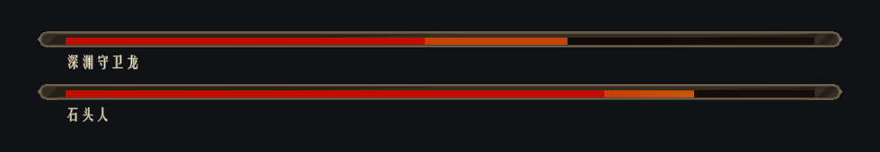

# Enemy 屏幕血条（2026-10-16）

## 效果与出现条件

石头人、深渊守卫龙开始追击玩家后，在屏幕中下方显示长条血槽。名称位于各自血槽下方，两名敌人同时索敌时纵向排列，第二条显示在第一条上方。血条跟随敌人 AI 的交战状态，不需要玩家手动锁定敌人。

- 使用项目 GUI Kit The Stone 的加载条边框和填充素材，配合暗红血槽、暖金名称与损血残影。
- 真实生命变化通过 `EnemyStats.ResourceChanged` 更新。受到伤害时红条立即减少，金色残影停留 0.35 秒后消退；治疗时立即补齐。
- 追击、攻击、攻击等待、受击状态显示；待机、巡逻、脱战返回时收起。
- 敌人死亡后短暂保留零血状态，再淡出；敌人禁用、销毁，以及玩家死亡后也会收起。
- 所有血条图像与文字关闭射线检测，容器不接收点击。

双敌预制体渲染，使用示例血量：

## 预制体与调整入口

| 位置 | 用途 |
| --- | --- |
| `Assets/Resources/Prefabs/UI/EnemyBossHealthBar.prefab` | 可复用单行预制体，包含血槽、损血残影、名称和 CanvasGroup。美术样式在此编辑。 |
| `Assets/Resources/Prefabs/UI/EnemyBossHealthCanvas.prefab` | 屏幕容器，引用单行预制体，控制安全区、底部距离和行距。 |
| `Assets/Resources/Prefabs/UI/UIManager.prefab` | 新增 `EnemyBossHealth` 面板，在 TestAct、Demo 1 中自动创建。 |
| 两个 Enemy 预制体上的 `EnemyBossHealthTarget` | 已接入石头人和龙；可通过 Display Name Override 修改 UI 名称。留空则读取数值配置中的 DisplayName。 |
| `Assets/ArtRes/UI Res/BossHealthName.mat` | 名称专用 TMP 描边及阴影材质，改善亮背景下的可读性。 |

参考设计分辨率为 1920×1080，CanvasScaler 使用屏幕适配：

- 血条左右各留 15% 安全区宽度。
- `UIEnemyBossBars.Bottom Offset = 104`，决定最底一行到安全区底边的距离。
- `Row Spacing = 88`，每行高度 70，整行间额外留白 18。
- 单行血槽高 32；名称从行顶下移 37，独立占用 28 高度，血槽与名称间留白 5。
- 运行时整行淡入/淡出，名称与对应血槽保持共同位置。

## 代码

- `Assets/Scripts/UI/HUD/EnemyBossHealthTarget.cs`：敌人登记、名称来源和交战条件。
- `Assets/Scripts/UI/HUD/UIEnemyBossBar.cs`：单行血量订阅、名称与损血残影。
- `Assets/Scripts/UI/HUD/UIEnemyBossBars.cs`：多目标自动绑定、排列、安全区与生命周期。

新增其他敌人时，给敌人预制体添加 `EnemyBossHealthTarget` 即可复用。新的游戏场景需要加入 UIManager 中 EnemyBossHealth 条目的 Scene Paths。

## 验证

- Unity 编译及真实 Play 验证通过：单敌一条、双敌两条、名称分别正确、血量与数值一致。
- 验证 HUD 关闭再开启不会重复生成；敌人禁用仅移除对应行；重新激活恢复；死亡停留后收起；脱战后收起。
- 使用实际预制体渲染并检查 1920×1080、1280×720、2560×1080、1024×768，整行都位于屏幕内，名称与血槽不重叠。检查了暗色和明亮背景。
- 测试脚本、完整截图和结果在被忽略的 `Logs/BossHealthUI/`。
- 测试已退出并恢复测试前存档，未保存 TestAct 原有的未保存场景改动。
