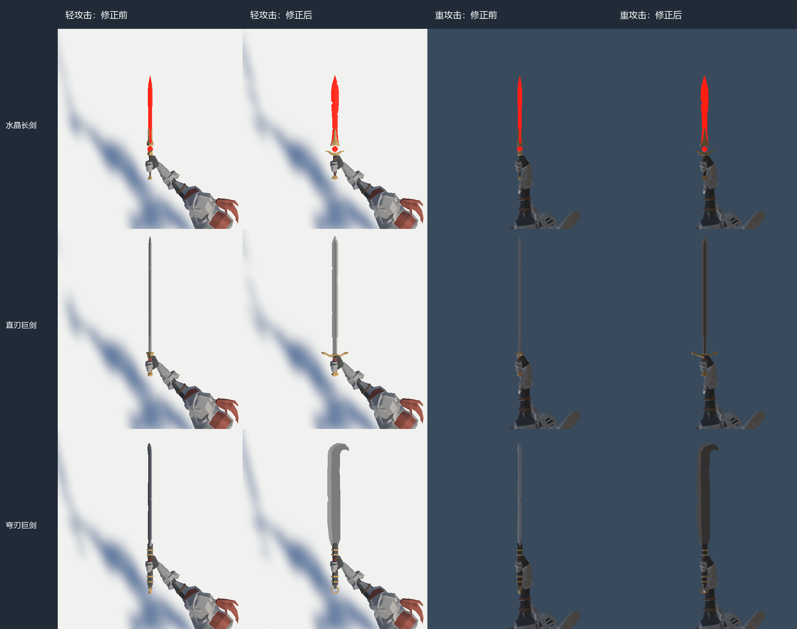
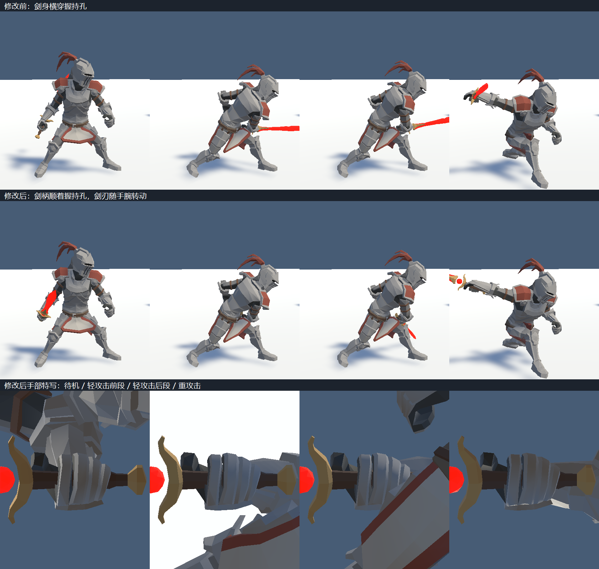
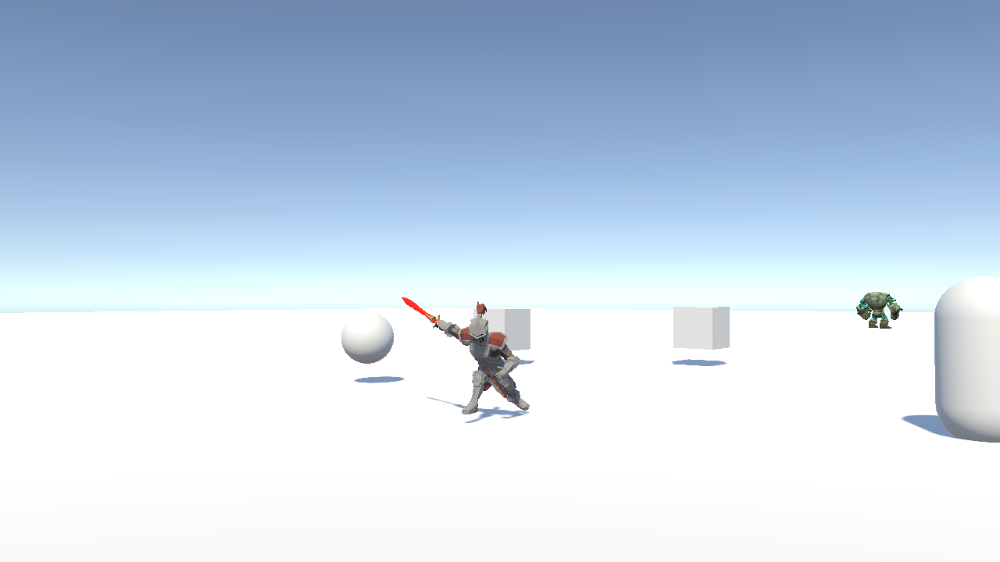

# 武器握持修正 · 2026-10-16

> **后续维护必读（2026-10-22）**：[持剑绑定规范与防回退说明](持剑绑定规范与防回退说明.md) 汇总了正确基准、Demo 1 的数据链及生成器覆盖风险。本次发现九件武器回退到旧角度后，已按用户要求恢复为下表配置，位置和缩放保持原值；生成器也已同步相同角度，避免生成操作再次写回旧值。后续维护请遵守根目录 `AGENTS.md` 的保护约定。

> **最新状态**：后续按用户反馈补充了刃面绕柄轴的 90° 修正。握持位置正确不代表刃面正确；以下配置表已更新为最终保存值，原有底部两张图仅记录第一轮握持修正。最新对比见“刃面修正”一节。

## 原因

旧朝向 `Quaternion.Euler(-90, 90, 0)` 将武器的本地 `+Y` 长轴转到了右手本地 `-X`，横穿手指围成的握持孔。问题来自装备朝向，攻击动画本身无需修改。

在运行中的 `TestAct` 场景检查右手弯曲后的指骨和网格：食指位于本地 Z 约 -2.7，中间手指组位于 Z 约 +3.3；柄应沿 Z 穿过这两侧，剑刃从拇指/食指侧（-Z）伸出。局部位置 `(9, 3.6, 0)` 已落在孔内，因此保留该位置。

另一个旧假设“武器本地 Y=0.1 是柄中心”不成立：水晶长剑在 Y 约 0.10～0.19 已是护手区域。不能再用这个采样点对齐食指和拇指根部的中点。

## 保存的配置

修改 `Assets/GameData/Definitions/Items/Equip_2000_Weapon.asset` 至 `Equip_2008_Weapon.asset` 的 `equipmentEuler`。

| 武器 | 位置 | 欧拉角 | 缩放 |
|---|---|---|---|
| 2000 水晶长剑、2002 华丽之剑、2003 弯刀、2004 手斧、2008 弯刃巨剑 | (9, 3.6, 0) | (0, 90, -90) | 100 |
| 2001 直刃巨剑 | (9, 3.6, 0) | (90, 0, 180) | 100 |
| 2005 短锤、2006 长矛、2007 法杖 | (9, 3.6, 0) | (-90, 0, 0) | 100 |

上述朝向均满足 `rotation * Vector3.up = (0, 0, -1)`。直刃巨剑的宽轴为模型 X，其他剑、刀及手斧的宽轴为模型 Z；它们需要分别配置旋转，不能直接统一欧拉角。

## 刃面修正（第二轮）

用户确认第一轮握持位置正确，但挥砍时仍用宽剑面迎敌。第一轮仅修正长轴，并未验证刃面与攻击轨迹，原先认为“刃面已对应”的判断不成立。

本轮将 2000、2001、2002、2003、2004、2008 在第一轮姿态基础上绕武器本地 Y 轴转 +90°，即 `oldRotation * Quaternion.AngleAxis(90, Vector3.up)`。该组合保持柄中心和长轴不变；不是直接给 Inspector 的 Y 加 90。手斧的 +Z 斧刃由此朝手部 +X，对应主要正手挥砍方向。短锤、长矛和法杖保留第一轮配置。

验证结果：

- 六件武器通过实际 `Equip`、收剑与再次拔剑检查；位置仍为 `(9, 3.6, 0)`，长轴仍为手部 `-Z`，世界缩放仍为 1；背挂角仍为 `(0, 0, 140)`，命中盒存在。
- 对六段攻击按动画 `AttackHit` / `AttackHitEnd` 事件窗口采样剑身运动。五段的剑面法向运动明显减少；轻攻击 `Attack_02` 的该分量平方和由 0.2236 降至 0.0526，重攻击 `Attack_01` 由 2.1338 降至 0.1544。这用于比较修正前后，数值本身不是伤害或游戏速度。
- **已知限制**：第三段轻攻击 `Attack_06` 的手腕运动方向不同，该窗口内剑面法向运动反而增大（0.0120 → 0.0539）。固定挂载角度不能让它与其余五段同时完全对齐。本轮仅修正装备配置，没有更改该动画，也没有加入随攻击状态自动拧剑的补偿。
- 对水晶长剑、直刃巨剑、弯刃巨剑分别渲染轻攻击 0.23、重攻击 0.39 的手部对比；同一姿势前后只变更剑身绕柄轴的角度。
- 验证结束已退出 Play 模式并恢复验证前存档；未保存或重载原本就有未保存修改的 `TestAct` 场景。

最新对比图各行依次为水晶长剑、直刃巨剑、弯刃巨剑；各列为轻攻击修正前/后、重攻击修正前/后。相机朝向校正后的剑面法线，因此修正后能看到更宽的剑面；判定是否用锋刃挥砍依据运动方向，而非屏幕上显示的宽窄。

## 第一轮握持验证（历史记录）

- Unity Play 模式检查待机、`Attack_02` 的 0.35 / 0.65 关键帧、`Attack_01` 的 0.45 关键帧与手部特写；修正后柄沿握持孔穿过。
- 逐一调用实际 `PlayerOutfit.Equip`，确认 9 个实例到手后的长轴均为手骨本地 -Z，世界缩放均为 1；收剑后父节点回到 `SM_Item_Sword`，背挂角仍为 (0, 0, 140)。
- 使用当前游戏相机拍摄重攻击姿势，确认实际相机下的朝向。
- 验证后退出 Play 模式、恢复 Time.timeScale 和 Animator.speed，并还原验证前备份的单槽存档。

多姿势的同步离线对比使用当前角色的 `SkinnedMeshRenderer.BakeMesh`，确保图中角色网格与当次采样的手骨一致；仅 `Animator.Update(0)` 后立刻用临时相机渲染可能出现网格与骨骼帧不同步，这也会造成武器“漂浮”的假象。

