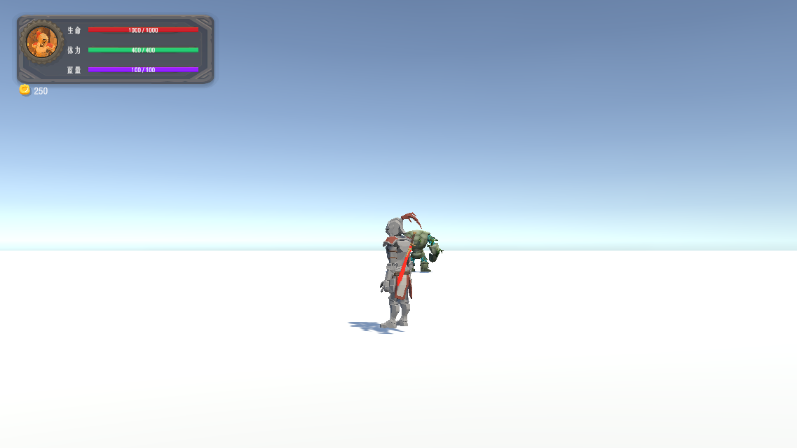

# 第三人称视角恢复（2026-10-16）

## 原因

当前 TestAct 编辑器场景的 FreeLook 三条轨道半径被缩短为 0.5646 / 0.6112 / 0.5646 米，镜头贴在角色背部。Cinemachine 的 Save During Play 已开启，而 CameraModeController 会在运行时直接改变轨道半径以处理避障和锁定构图；退出运行时，这些临时半径被带回编辑器场景，下次运行再次作为基础半径使用。

磁盘场景及 Git HEAD 中仍保留设计半径 9.721067 / 10.52292 / 9.721067 米，轨道高度为 2.5 / 1.5 / 0.5 米。本次从磁盘恢复当前场景相机的三条轨道，未保存或重新加载当前场景，原有未保存编辑继续保留。

## 修改

`Assets/Scripts/Camera/CameraModeController.cs` 在 Cinemachine 的 `OnHotSave` 回调中恢复基础半径，避免避障缩放或锁定扩距被保存到设计配置。控制器停用时也恢复基础半径并清除临时缩放及扩距，启用时重新订阅回调。

不需要关闭整个 Cinemachine 的 Save During Play。其他相机调试仍可以使用该功能。

## 验证

- Unity 脚本编译通过。
- 正常开阔场景恢复第三人称距离。
- 实体墙遮挡会缩短相机距离，移除墙后恢复基础距离。
- 锁定目标仍然扩展构图距离，停用控制器恢复基础半径。
- 在相机被墙挤近时退出 Play，三条设计半径均保持不变。
- 再次进入 Play 仍以正确基础距离启动，再次退出也未污染参数。
- 测试已结束并恢复测试前存档。测试日志位于 `Logs/CameraFix/results.txt`。

